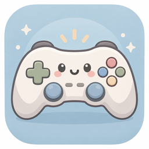
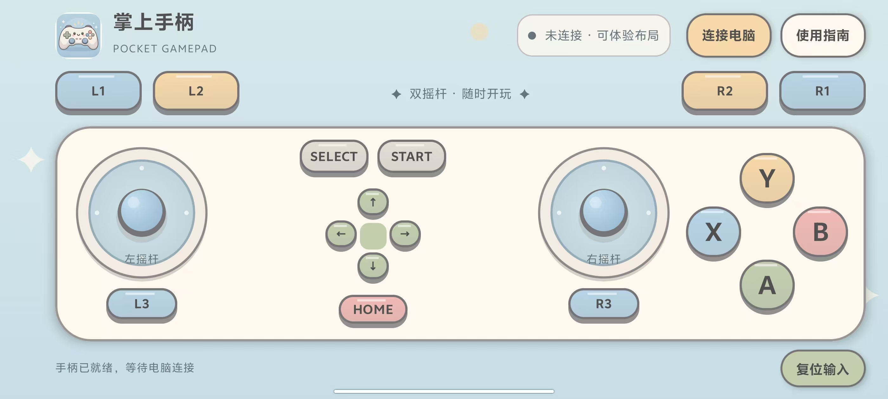

<p align="center"></p>

<h1 align="center">Pocket Gamepad</h1>

<p align="center">Give your phone a second job: gamepad.</p>

<p align="center"><a href="README.md">简体中文</a> · <b>English</b></p>

<p align="center">
  
  
  
</p>

<p align="center"><a href="https://github.com/aplainjane/Mobile_Gamepad/releases">Download APK</a> · <a href="#getting-started">Getting started</a> · <a href="#a-few-questions">FAQ</a> · <a href="https://github.com/aplainjane/Mobile_Gamepad/issues">Feedback</a></p>

This started with a small question: a phone already has a touchscreen and Bluetooth, so could it double as a PC controller? I put together two sticks, a set of buttons, and a pastel interface that feels a little like a toy. Making it work has been half the fun.

Pocket Gamepad is an Android app that sends controller input to Windows through the phone's Bluetooth HID interface. **No root, project-specific PC receiver, or virtual gamepad driver required.** Set up Steam Input, then give it a go in a game.

## A look inside

<p align="center"></p>

Two sticks, pastel buttons, and slightly raised edges. This is a screenshot of the current app; the app interface is currently in Chinese.

## What you get

- Dual analog sticks, ABXY, D-pad, shoulders, triggers, Select / Start / Home, and L3 / R3.
- Multitouch: hold a stick and press buttons together. Sticks return to center on release.
- A direct Bluetooth connection, with no account or shared Wi-Fi network needed.
- Local touch haptics and a reset button to release all inputs.
- A screen that stays awake while the app is in the foreground.

A touchscreen doesn't have the feel of physical buttons. Still, it's a fun way to try a game when you don't have a controller handy—or to see what else your phone can do.

## Getting started

You'll need an **Android 9+ phone with Bluetooth HID Device support** and a Bluetooth-capable Windows PC. The Android version alone isn't enough; the phone manufacturer also needs to expose the HID Device feature.

### 1. Install and pair

Download the APK from [Releases](https://github.com/aplainjane/Mobile_Gamepad/releases) and install it on your phone. The current version is **3.0.3, a test build**, with `debug` in the filename.

1. Tap **连接电脑** (Connect to PC), grant Bluetooth permissions, and start the controller.
2. Tap **允许电脑发现手机** (Make phone discoverable). In Windows, open **Bluetooth & devices → Add device → Bluetooth**, select your phone, and confirm the pairing code on both devices.
3. Back in the app, select your PC from the paired devices and tap **连接** (Connect). Close the dialog to start using the controls.

### 2. Check the input

Press `Win + R` on Windows, enter `joy.cpl`, and open the controller properties. Try both sticks, the buttons, and the D-pad.

If you used an older build with a different HID descriptor, remove the old Windows pairing and pair again. The UI updates between 3.0 and 3.0.3 do not require re-pairing.

### 3. Set up Steam

Open **Steam → Settings → Controller**, find Pocket Gamepad or the generic controller, test the input, and define its layout. Enable Steam Input under the game's **Properties → Controller**, then launch the game from Steam.

Menu names vary between Steam versions. A generic HID device may need its layout defined first; the absence of a connection popup doesn't tell you whether input is working.

**Keep the app in the foreground while playing.** Moving it to the background or closing it releases all inputs and disconnects the controller. Reconnect when you return.

## A few questions

**Does every Steam game work?**

That isn't verified. Development testing has mainly used an Android 15 phone and Windows, with successful use reported after defining the layout in Steam. Compatibility depends on the game and its Steam Input configuration. For other games, you can try adding them to your Steam library.

**The controller connects, but the buttons are wrong.**

Check the layout in Steam first. Windows, browser testers, and games may interpret a generic controller differently. An empty browser `standard` mapping doesn't mean the device wasn't detected. Raw axis and button indices are listed in the [protocol notes](docs/PROTOCOL.md) (Chinese).

**Steam says controller support is unknown.**

That message relates to the game's support metadata and controller classification. Check the input test in Steam and the actual controls in the game.

**What about rumble and analog triggers?**

The current app provides local touch haptics only, with no game rumble feedback. Touchscreen triggers currently have pressed and released states, without half-press control.

**It won't connect.**

Keep the app open, grant Bluetooth permissions, and close other Bluetooth keyboard or mouse emulation apps that might occupy the HID feature. Try removing the old pairing on both devices. Some phone systems don't expose Bluetooth HID Device support.

## Build it yourself

Built with Kotlin, Jetpack Compose, and Android `BluetoothHidDevice`. Open the project root in Android Studio, use JDK 21 and Android SDK 36.1, and let Gradle sync.

```powershell
.\gradlew.bat :app:assembleDebug
```

The APK is written to `app/build/outputs/apk/debug/app-debug.apk`. To run the existing report tests and static checks:

```powershell
.\gradlew.bat :app:testDebugUnitTest :app:lintDebug
```

The original icon is in [artwork/launcher-icon.png](artwork/launcher-icon.png). With Pillow installed, run `python tools/Generate-LauncherIcons.py` to regenerate the launcher assets. See the [protocol notes](docs/PROTOCOL.md) for input fields and read-only diagnostic scripts.

## Try it, break it, tell me about it

Feedback on phone compatibility, button layouts, and the interface is welcome in [Issues](https://github.com/aplainjane/Mobile_Gamepad/issues). Include your phone model, Android version, game, and what happened. A few steps to reproduce the problem help a lot.

For publishing your own copy, there's also a [GitHub and Release guide](docs/PUBLISHING.md) (Chinese).
